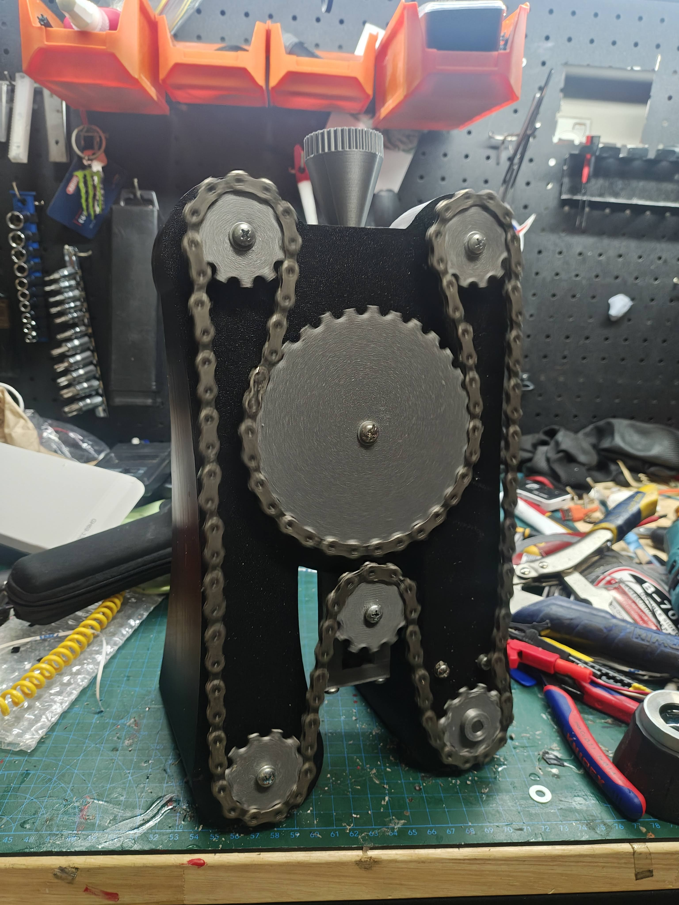

# WaxedChainBreaker V2

A work-in-progress 3D design project, shared for the community to download, modify and improve.

## Project status

This design is unfinished. The files are an initial development snapshot; assembly instructions, print settings and a bill of materials have not yet been documented or validated.

## Files

- **WaxedChainBreaker2.f3d** — native Autodesk Fusion design archive; start here to edit the design.
- **WaxedChainBreaker V2.step** — CAD exchange file for other modelling tools.
- **WaxedChainBreaker V2.stl** — mesh export for viewing or slicing.
- **prototype.jpg** — prototype photo.
- **prototype.mp4** — project video ([download/view](prototype.mp4)).

Use **Code → Download ZIP** to download the complete project, or open an individual file to download it.

## Contributing

Everyone is welcome to help. Open an issue for feedback, questions, bugs or ideas. To propose an update, fork this repository, make your changes and open a pull request. Include a short explanation and screenshots or photos where useful. For CAD changes, include the editable source and refreshed STEP/STL exports where relevant.

Useful contributions include design refinements, print settings, assembly notes, a bill of materials and reports from builds. Maintainers review and merge proposed updates.

## License

Shared under the [MIT License](LICENSE). Contributions are submitted under the same license.
